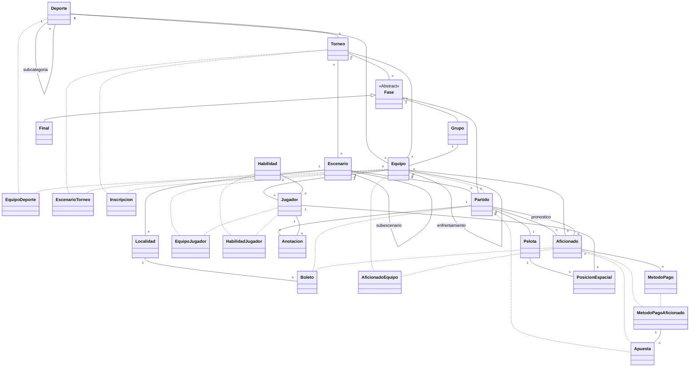

# Modelo Conceptual y Relacional de Entidades

Este documento traduce el diagrama de clases/entidades del sistema a texto estructurado para que los agentes de IA lo consuman directamente sin necesidad de procesar imágenes repetidamente.

> **Nota de precedencia (SDD):** Este archivo define la estructura conceptual del dominio. Para nombres exactos de tablas, columnas, rutas HTTP y reglas específicas de la Entrega 2, prevalece siempre `ACUERDOS.md` junto con `HISTORIAS_USUARIO.md`.

## 1. Convenciones del Diagrama

* **Clasificación `S.I` (Marca Roja — Solo Backend):** Entidades a las que se les desarrolla **únicamente Backend** (API, servicios, repositorios y persistencia), **NO llevan vistas/componentes en Frontend**.
* **Clasificación `I.R` (Marca Verde — Backend + Frontend):** Entidades operativas y asociativas a las que se les desarrolla **tanto Backend como Frontend**.
* **Alcance `ms-gestion-deportiva` (Resaltado Azul):** Entidades que pertenecen al dominio de **Gestión Deportiva y Gestión de Competencias** (dentro del alcance de este microservicio, sujeto a los filtros de entrega en `HISTORIAS_USUARIO.md` y `ACUERDOS.md`).
* **Fuera de `ms-gestion-deportiva` (Sin resaltado azul):** Entidades pertenecientes a otros módulos/microservicios o entregas posteriores (boletería, aficionados, apuestas/pagos y telemetría espacial).

## 2. Diagrama Estructural Completo (Mermaid)

## 3. Entidades de `ms-gestion-deportiva` (Resaltado Azul)

| Entidad | Marca | Alcance de Desarrollo | Tipo / Rol en el Dominio | Relaciones Principales |
| :--- | :--- | :--- | :--- | :--- |
| **`Fase`** | `S.I` (Roja) | **Solo Backend** | Clase abstracta (`<<Abstract>>`) | Pertenece a `Torneo` (`N:1`); padre de `Grupo` y `Final`; agrupa `Partido` (`1:N`). |
| **`Grupo`** | `S.I` (Roja) | **Solo Backend** | Subclase de `Fase` | Hereda de `Fase`; agrupa `Equipo` (`1:N`). |
| **`Final`** | `I.R` (Verde) | **Backend + Frontend** | Subclase de `Fase` | Hereda de `Fase`. |
| **`Deporte`** | `S.I` (Roja) | **Solo Backend** | Catálogo / Jerarquía | Autorreferencia `1:N`; se asocia con `Torneo` (`1:N`) y con `Equipo` (`N:N` vía `EquipoDeporte`). |
| **`Habilidad`** | `S.I` (Roja) | **Solo Backend** | Catálogo | Se asocia con `Jugador` (`N:N` vía `HabilidadJugador`). |
| **`Torneo`** | `I.R` (Verde) | **Backend + Frontend** | Entidad núcleo | Pertenece a `Deporte` (`N:1`); tiene `Fase` (`1:N`), `Escenario` (`N:N` vía `EscenarioTorneo`) y `Equipo` (`N:N` vía `Inscripcion`). |
| **`Inscripcion`** | `I.R` (Verde) | **Backend + Frontend** | Clase asociativa | Resuelve `Torneo` (`N`) ↔ `Equipo` (`N`). |
| **`Escenario`** | `I.R` (Verde) | **Backend + Frontend** | Entidad núcleo / Jerarquía | Autorreferencia `1:N`; tiene `Partido` (`1:N`), `Localidad` (`1:N`) y se asocia con `Torneo` (`N:N` vía `EscenarioTorneo`). |
| **`EscenarioTorneo`** | `I.R` (Verde) | **Backend + Frontend** | Clase asociativa | Resuelve `Torneo` (`N`) ↔ `Escenario` (`N`). |
| **`Equipo`** | `I.R` (Verde) | **Backend + Frontend** | Entidad núcleo | Asociado a `Grupo` (`N:1`), `Deporte` (`N:N`), `Torneo` (`N:N`), `Jugador` (`N:N`), `Aficionado` (`N:N`) y `Equipo` (`N:N` vía `Partido`). |
| **`EquipoDeporte`** | `I.R` (Verde) | **Backend + Frontend** | Clase asociativa | Resuelve `Equipo` (`N`) ↔ `Deporte` (`N`). |
| **`EquipoJugador`** | `I.R` (Verde) | **Backend + Frontend** | Clase asociativa | Resuelve `Equipo` (`N`) ↔ `Jugador` (`N`). |
| **`Jugador`** | `I.R` (Verde) | **Backend + Frontend** | Entidad núcleo | Asociado a `Equipo` (`N:N`), `Habilidad` (`N:N`), `Anotacion` (`1:N`) y `PosicionEspacial` (`1:N`). |
| **`HabilidadJugador`** | `I.R` (Verde) | **Backend + Frontend** | Clase asociativa | Resuelve `Habilidad` (`N`) ↔ `Jugador` (`N`). |
| **`Partido`** | `I.R` (Verde) | **Backend + Frontend** | Entidad operativa / Asociativa | Resuelve enfrentamiento `Equipo` (`N`) ↔ `Equipo` (`N`); pertenece a `Fase` (`N:1`) y `Escenario` (`N:1`); tiene `Anotacion` (`1:N`) y `Pelota` (`1:1`). |
| **`Anotacion`** | `I.R` (Verde) | **Backend + Frontend** | Entidad operativa | Pertenece a `Partido` (`N:1`) y a `Jugador` (`N:1`). |

## 4. Entidades Fuera de `ms-gestion-deportiva` (Sin Resaltado Azul)

Se documentan como referencia para contratos de integración entre microservicios o entregas posteriores:

| Entidad | Marca | Alcance de Desarrollo | Módulo / Contexto | Relaciones Principales |
| :--- | :--- | :--- | :--- | :--- |
| **`MetodoPago`** | `S.I` (Roja) | **Solo Backend** | Pagos / Entregas posteriores | Se asocia con `Aficionado` (`N:N` vía `MetodoPagoAficionado`). |
| **`Pelota`** | `S.I` (Roja) | **Solo Backend** | Telemetría / Tracking | Asociada `1:1` con `Partido` y `1:N` con `PosicionEspacial`. |
| **`PosicionEspacial`** | `S.I` (Roja) | **Solo Backend** | Telemetría / Tracking | Pertenece a `Jugador` (`N:1`) y a `Pelota` (`N:1`). |
| **`Localidad`** | `I.R` (Verde) | **Backend + Frontend** | Boletería | Pertenece a `Escenario` (`N:1`); tiene `Boleto` (`1:N`). |
| **`Boleto`** | `I.R` (Verde) | **Backend + Frontend** | Boletería | Clase asociativa entre `Partido` (`N`) ↔ `Aficionado` (`N`), vinculada a `Localidad` (`N:1`). |
| **`Aficionado`** | `I.R` (Verde) | **Backend + Frontend** | Aficionados / Boletería | Se asocia con `Equipo` (`N:N`), `Partido` (`N:N` vía `Boleto` y `Apuesta`) y `MetodoPago` (`N:N`). |
| **`AficionadoEquipo`** | `I.R` (Verde) | **Backend + Frontend** | Aficionados | Clase asociativa entre `Equipo` (`N`) ↔ `Aficionado` (`N`). |
| **`Apuesta`** | `I.R` (Verde) | **Backend + Frontend** | Apuestas (Entrega 3) | Clase asociativa entre `Partido` (`N`) ↔ `Aficionado` (`N`), vinculada a `MetodoPagoAficionado` (`N:1`). |
| **`MetodoPagoAficionado`** | `I.R` (Verde) | **Backend + Frontend** | Pagos / Apuestas | Clase asociativa entre `Aficionado` (`N`) ↔ `MetodoPago` (`N`); tiene `Apuesta` (`1:N`). |